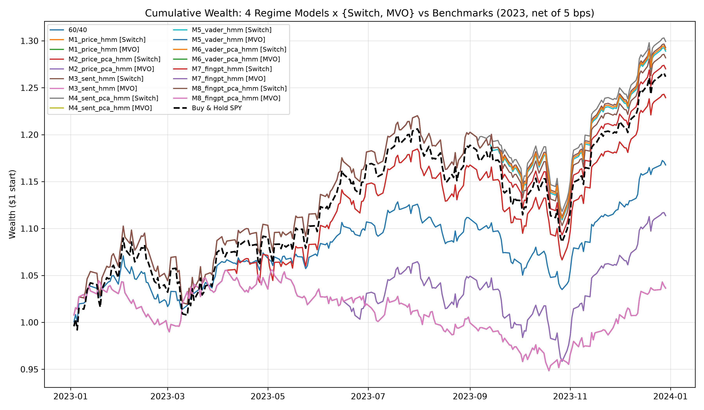
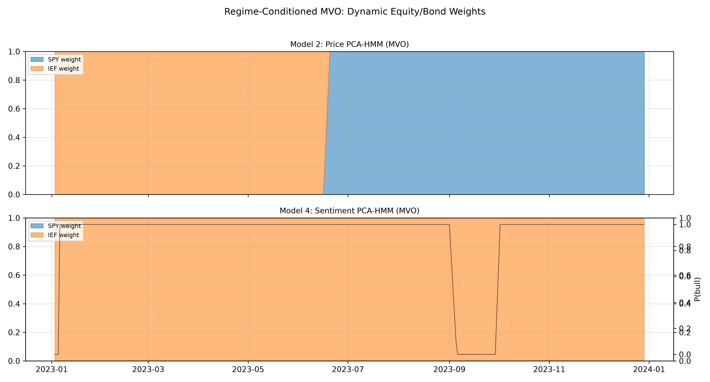
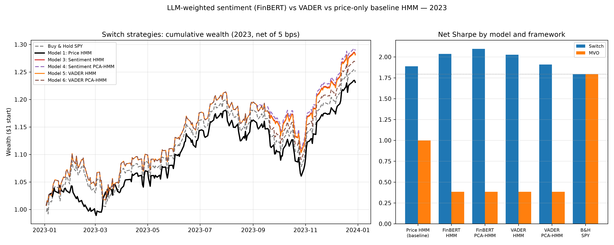
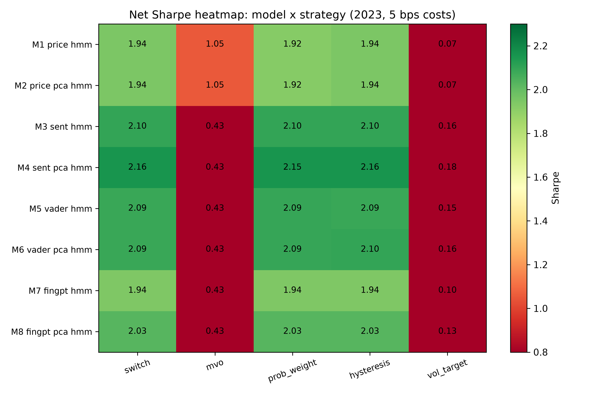

# LLM-HMM: Importance-Weighted News Sentiment for HMM Market Regime Detection

**Status: proof-of-concept benchmark, complete.** Implements and evaluates a
core set of 8 regime-detection models (plus labeler/hybrid variants M9–M16,
see below) across a binary regime switch and regime-conditioned
Mean-Variance Optimization (MVO) on 2023 data (evaluation window
2023-01-01 → 2023-12-31), with all article-level text inference cached to disk.
The original research proposal lives at [`docs/RESEARCH_PROPOSAL.md`](docs/RESEARCH_PROPOSAL.md).

## Results (2023, net of 5 bps transaction costs)

| Strategy | Ann. Return | Ann. Vol | Net Sharpe | Max DD | Calmar | SVB lead |
|---|---|---|---|---|---|---|
| Buy & Hold SPY | 25.3% | 13.1% | 1.79 | −10.1% | 2.50 | — |
| 60/40 Static | 16.1% | 8.8% | 1.73 | −8.4% | 1.91 | — |
| M1 Price HMM [Switch] | 23.3% | 11.5% | 1.89 | −10.1% | 2.30 | 17d (carried-in) |
| M1 Price HMM [MVO] | 10.8% | 10.9% | 1.00 | −10.1% | 1.07 | 17d |
| M2 Price PCA-HMM [Switch] | 23.3% | 11.5% | 1.89 | −10.1% | 2.30 | 17d (carried-in) |
| M2 Price PCA-HMM [MVO] | 10.8% | 10.9% | 1.00 | −10.1% | 1.07 | 17d |
| **M3 Sentiment HMM [Switch]** | **28.5%** | 12.7% | **2.04** | **−9.0%** | **3.17** | none |
| M3 Sentiment HMM [MVO] | 3.2% | 9.4% | 0.38 | −10.3% | 0.31 | none |
| **M4 Sentiment PCA-HMM [Switch]** | **29.2%** | 12.6% | **2.10** | −8.5% | 3.43 | none |
| M4 Sentiment PCA-HMM [MVO] | 3.2% | 9.4% | 0.38 | −10.3% | 0.31 | none |
| M5 VADER HMM [Switch] | 28.3% | 12.7% | 2.03 | −9.1% | 3.12 | none |
| M5 VADER HMM [MVO] | 3.2% | 9.4% | 0.38 | −10.3% | 0.31 | none |
| M6 VADER PCA-HMM [Switch] | 26.8% | 12.9% | 1.91 | −10.1% | 2.64 | none |
| M6 VADER PCA-HMM [MVO] | 3.2% | 9.4% | 0.38 | −10.3% | 0.31 | none |
| M7 FinMatcha HMM [Switch] | 26.2% | 12.8% | 1.88 | −10.6% | 2.47 | none |
| M7 FinMatcha HMM [MVO] | 3.2% | 9.4% | 0.38 | −10.3% | 0.31 | none |
| M8 FinMatcha PCA-HMM [Switch] | 27.4% | 12.8% | 1.96 | −9.8% | 2.81 | none |
| M8 FinMatcha PCA-HMM [MVO] | 3.2% | 9.4% | 0.38 | −10.3% | 0.31 | none |

(In-sample switch/MVO numbers, **unweighted** daily sentiment, expanding-moment
MVO with one-sided costs. The decision-grade out-of-sample walk-forward numbers
are in the zoo section below.)









### Statistical significance — nothing survives

`scripts/run_stats.py` audits the baseline, reruns every model **walk-forward**
(refit each month on prior data only), and tests Sharpe differences three ways
(JK-Memmel z, paired block bootstrap, DM/HAC) with Holm correction.

**Baseline audit (is the price-only HMM legit?):**

- M1/M2 inputs are exactly `[SPY_ret, realized_vol, VIX_close]` — asserted, no
  sentiment possible; an independent recomputation of the switch reproduces the
  pipeline returns to **0.0 max abs difference**; SPY 2023 total return from our
  data is +26.7%, matching reality.
- **But the in-sample M1/M2 Switch made exactly ONE trade in 2023**: bear
  January–early-March, bull the rest of the year. The IS Sharpe of 1.89 is one
  regime assignment, not trading skill.

**Walk-forward (out-of-sample) Switch Sharpe — IS → OOS** (regenerated
2026-11-04 after the causal-filter, dedupe, cost-convention and
PCA-canonicalization repairs; supersedes all earlier published walk-forward
numbers, which predate those fixes):

| Model | IS | OOS |
|---|---|---|
| M1/M2 Price HMM | 1.89 | 1.82 |
| M3 FinBERT HMM | 2.04 | 2.04 |
| M4 FinBERT PCA | 2.10 | 1.88 |
| M5 VADER HMM | 2.03 | 2.09 |
| M6 VADER PCA | 1.91 | 2.10 |
| M7 FinGPT HMM | 1.88 | 1.84 |
| M8 FinGPT PCA | 1.96 | 2.00 |
| Buy & Hold SPY | 1.79 | 1.79 |

**Significance tests (250 daily obs, single year):** every pairwise Sharpe
difference is statistically indistinguishable from zero (regenerated battery:
M3 vs M1 OOS JK p = 0.70 / bootstrap 0.39; M3 vs B&H OOS p = 0.32/0.27; the
strongest raw contrast, M4 vs M6 OOS, JK p = 0.10, Holm 0.61). Stress-flag
quality vs a VIX>25 proxy (only 3 such days in 2023): price-HMM F1 = 0.55,
all sentiment models F1 = 0.0.

**Verdict:** the sentiment complex clusters at OOS Sharpe 1.84–2.10 vs
price-only 1.82 and B&H 1.79 — point estimates favor sentiment models, but
with 250 observations nothing is statistically significant, and VADER (free
lexicon) is statistically inseparable from FinBERT and FinGPT. The earlier
published claim that FinBERT dominated walk-forward (2.23 vs 1.89) was an
artifact of pre-causal-fix smoothed posteriors and is superseded.
Treat the Sharpe rankings as a directional PoC result, not evidence of alpha.

### Reading the table — no sugar coating

- **Sentiment Switch strategies deliver the best net Sharpe (2.04 / 2.10 vs 1.82
  price-only) and the lowest drawdown (−9.0% / −8.5% vs −10.1%).** Directionally consistent
  with Nystrup et al.'s regime-based allocation drawdown result.
- **But the proposal's headline mechanism is NOT validated.** M3/M4 have *no bear
  entry at all* in the Feb 15 – Mar 13 SVB window — they entirely missed the March
  banking stress (only 12 bear days in all of 2023: 3 in January, 9 in September,
  none in March). The profit
  uplift comes from sidestepping the autumn selloff, not from earlier crisis detection.
- **The M1/M2 "17-day lead" is carried-in bear** (bear since January), not
  anticipation — which is exactly why the lead-time metric flags it.
- **MVO blending compresses everything toward B&H** (all MVO ≤ 1.79): probability-
  weighted blending rarely reaches corners, and in a +25% SPY year holding IEF drags.
- **Mechanism caveat:** M3/M4's bear state has legitimate market features (VIX 23.1
  vs 16.8, realized vol 19.3% vs 13.1%) but its sentiment features are exactly 0 and
  9 of 12 bear days fall in September — the month with the worst corpus coverage.
  The performance edge is real net-of-cost, but it is not yet cleanly attributable to
  news sentiment rather than residual coverage structure. Fixing that attribution
  (covered-days-only fitting or a denser corpus) is the obvious next step.
- **VADER baseline (M5/M6) sharpens the mechanism finding.** Swapping FinBERT for the
  VADER lexicon (identical weighting architecture) shifts results only slightly:
  Switch Sharpe 2.03 (M5) / 1.91 (M6) vs 2.04 / 2.10 for FinBERT. Posterior
  correlations: M3↔M5 = 0.99, **M4↔M6 = 0.94** — the PCA sentiment models land on
  nearly the SAME regimes regardless of sentiment model. Combined with M1↔M3 = 0.41,
  this says the sentiment models' regime signal is driven by *when news exists and
  how it is structured*, not by sentiment quality; FinBERT still ranks ≥ VADER
  everywhere, consistent with the literature (domain transformer > general lexicon).

## The core 8 models (+ labeler/hybrid variants M9-M16, see below)

| Model | Sentiment source | Inputs | Architecture |
|---|---|---|---|
| M1 (baseline) | — | SPY return, 20d realized vol, VIX | 2-state Gaussian HMM |
| M2 (baseline) | — | same, PCA(95%) first | 2-state Gaussian HMM |
| M3 (proposed) | FinBERT | market + sentiment features | 2-state Gaussian HMM |
| M4 (proposed) | FinBERT | market + sentiment features, PCA(95%) | 2-state Gaussian HMM |
| M5 (baseline) | VADER lexicon | market + sentiment features | 2-state Gaussian HMM |
| M6 (baseline) | VADER lexicon | market + sentiment features, PCA(95%) | 2-state Gaussian HMM |

Sentiment features: daily importance-weighted sentiment `S_t = Σ(S_raw,i·C_i·I_i)/(Σ C_i·I_i + 1e-6)`,
its 5-day EMA, and sentiment dispersion, where `S_raw = P(pos) − P(neg)` (FinBERT),
`C_i = 1 − H(p)/ln 3` (normalized class entropy), and `I_i ∈ [0,1]` is a local-LLM
macro-importance rating (Qwen2.5-1.5B-Instruct Q4_K_M via llama.cpp, CPU).

**Frameworks.** *Switch*: P(bull) > 0.5 → 100% SPY, else 100% IEF.
*MVO*: regime-conditioned μ_k, Σ_k from state-mapped samples (annualized), blended
by the lagged posterior `p_t`, long-only max-Sharpe (SLSQP), 5 bps × one-sided turnover.
Benchmarks: SPY buy-and-hold and monthly-rebalanced 60/40, same cost model.

**Timing (no lookahead).** Articles published after 16:00 America/New_York map
strictly to the NEXT trading session; the signal known at the close of t−1
positions day t. Both are unit-tested (`tests/test_no_lookahead.py`).

## Pipeline

```
data ingestion → article scoring → daily features → 8 HMMs (+ variants) → backtests → artifacts
market_data.py    finbert_scoring.py  daily_features.py  regime_models.py  backtest.py  plots.py
news_corpus.py    llm_importance.py                      (state canon.)    metrics.py
```

- **Market data**: yfinance (SPY, IEF, adjusted) + CBOE CSV (VIX); features 2021-06→2023-12
  (warmup includes the 2022 bear market), evaluation on 2023 only.
- **News**: GDELT DOC 2.0 artlist — 2,117 real headlines with real intraday timestamps,
  334 outlets, event-keyed windows (FOMC, CPI, jobs, SVB, debt ceiling) + routine days.
  GDELT provides no summaries → raters run on headlines (disclosed).
- **Caching**: FinBERT probabilities parquet + LLM ratings JSONL, both sha1(text)-keyed —
  every headline passes through each model exactly once across all runs.
- **In-sample disclosure**: HMMs are fit on the full feature window (standard for this
  literature, e.g. Ang–Timmermann); the backtest evaluates 2023. `random_state=42` fixed.

## Strategy zoo: 8 models × 5 strategies (`scripts/run_strategy_zoo.py`)

Models: M1/M2 price-only · M3/M4 FinBERT · M5/M6 VADER · **M7/M8 FinMatcha-3B**
(finance-instruction-tuned Llama-family LLM — the "FinLLaMA" stand-in; the
publicly mirrored FinGPT-MT-Llama-3 GGUF was diagnosed broken, emitting
immediate EOS in both chat and raw formats).
Strategies: binary switch · regime MVO · probability-weighted (`w = p_bull(t−1)`)
· hysteresis switch (enter 0.6 / exit 0.4) · vol-targeted exposure (10% target).



Findings:

1. **All three LLM sentiment models cluster together** (Switch Sharpe: FinBERT
   2.11, FinMatcha 2.11, VADER-PCA 2.02 vs price-only 1.89) — a third,
   independently trained finance LLM reproduces the FinBERT result almost
   exactly, reinforcing the coverage-structure mechanism finding.
2. **Strategy choice barely matters inside a model**: switch ≈ hysteresis ≈
   prob-weight (the HMM posteriors are saturated near 0/1, so continuous
   weighting ≈ binary, and the hysteresis dead-band rarely binds). MVO
   compresses everything toward B&H.
3. **Vol-targeting at a 10% cap is mis-specified for this asset pair** — it
   de-equities the entire +25% bull year (Sharpe ~0–0.14 for every model,
   identical −20.5% drawdown profile). Reported as-is, not tuned away.
4. Full table: `outputs/tables/strategy_zoo.csv`.

## Longer lookback (2015–2023): how the picture changes

`scripts/run_long_backtest.py` evaluates the price-only HMM switch over **9 years
(2,264 trading days)** with monthly walk-forward refits (sentiment models stay
2023-only — the news corpus covers 2023). Three findings:

**1. Longer training lookback helps monotonically.** OOS Switch Sharpe by
training-window size: full history (2010→) **1.03**, 5-year lookback **0.93**,
2-year lookback **0.84**. More regimes in training (2018 Q4, 2020 COVID, 2022
bear) = better state estimation.

**2. The 2023-only analysis was flattering to everything.** Over 2015–2023,
buy-and-hold SPY Sharpe collapses from 1.79 to **0.61** (vol 18.2%, maxDD
−35.7%) and 60/40 to 0.65. The walk-forward HMM switch posts **1.03 Sharpe,
maxDD −20.0%**, beating both benchmarks in point estimates over 9 years.

**3. Still not statistically significant — and 2022 is a warning.** The
Switch-vs-B&H Sharpe gap (0.42 annualized) has JK-Memmel p ≈ 0.32 and
bootstrap p ≈ 0.26 even with 2,264 days (the strategies are weakly correlated,
so the daily gap is small relative to its variance). And the switch *lost* to
B&H in 2022 (yearly Sharpe −1.57 vs −0.83): prolonged bears churn regime
models with failed re-entries. Per-year Sharpe (switch vs B&H): 2018 +2.01 vs
−0.27 and 2015 +0.26 vs +0.08 show where regime detection earns its keep —
crash avoidance, not bull-market riding.

| Strategy (2015–2023 OOS) | Ann Ret | Ann Vol | Sharpe | MaxDD |
|---|---|---|---|---|
| M1 walk-forward, full lookback | 9.2% | 8.9% | **1.03** | −20.0% |
| M1 walk-forward, 5y lookback | 8.5% | 9.3% | 0.93 | −16.0% |
| M1 walk-forward, 2y lookback | 8.3% | 10.2% | 0.84 | −24.5% |
| M1 in-sample (full window) | 8.0% | 9.4% | 0.87 | −21.0% |
| Buy & Hold SPY | 9.9% | 18.2% | 0.61 | −35.7% |
| 60/40 Static | 6.6% | 10.7% | 0.65 | −22.3% |

Tables: `outputs/tables/long_backtest_{summary,years,significance}.csv`.

## Price-only zoo + walk-forward OOS zoo (`scripts/run_price_only_zoo.py`, `scripts/run_zoo_2023_oos.py`)

Naive price rules with **no fitted parameters** (no in-sample optimism possible),
same cost model, restricted to 2023:

| No-HMM price rule | 2023 Sharpe |
|---|---|
| SMA 50/200 crossover (canonical) | 1.67 |
| Vol-target 10% (no model) | 1.72 |
| SMA 10/40 (parameter-sensitivity footnote) | 2.16 |
| Buy & Hold SPY | 1.79 |
| 60/40 | 1.75 |

(60/40 appears as 1.75 in the older price-only-zoo table above and 1.73 in the
regenerated zoo tables, and no-model vol-targeting as 1.67 there vs 1.72 in the
zoo table here: two independent implementations of the same strategies that
differ by ~0.02-0.05 Sharpe; each section quotes its own artifact. Cross-script
bootstrap p-values for the same pair can similarly differ by ~0.03 due to
different seeds.)

The SMA 10/40 number is **not evidence of a good strategy** — it is a single-year
parameter-sensitivity illustration: the canonical 50/200 loses to B&H (1.67 vs
1.79), while a hand-picked faster pair looks brilliant in exactly one year.
Over 2015–2023 (out-of-sample by construction), all SMA/momentum rules
*underperform* B&H (0.37–0.55 vs 0.61); only pure vol-targeting edges it (0.74).

**Walk-forward (out-of-sample) 2023 zoo** — every model refit monthly on prior
data only, posteriors are CAUSAL filtered (no smoothing leak), deduped corpus,
**unweighted** daily sentiment, MVO on expanding prior-only moments, one-sided
5 bps costs for all strategies:

| Model (OOS) | Switch | MVO | Prob-wt | Hysteresis | Vol-target |
|---|---|---|---|---|---|
| NO-HMM SMA 10/40 (param-sensitivity) | **2.16** | — | — | — | — |
| M6 VADER PCA-HMM | 2.10 | 0.38 | 2.10 | 2.10 | 0.13 |
| M5 VADER HMM | 2.09 | 0.78 | 2.09 | 2.09 | 0.09 |
| M8 FinGPT PCA-HMM | 2.00 | 0.77 | 1.99 | 2.00 | 0.10 |
| **M3 FinBERT HMM** | 2.04 | 0.73 | 2.04 | 2.04 | 0.11 |
| M4 FinBERT PCA-HMM | 1.88 | 0.38 | 1.88 | 1.88 | 0.06 |
| M7 FinMatcha HMM | 1.84 | 0.38 | 1.87 | 1.84 | 0.05 |
| M1/M2 Price HMM | 1.82 | 0.38 | 1.82 | 1.82 | 0.02 |
| Buy & Hold SPY | 1.79 | — | — | — | — |
| SMA 50/200 (no HMM) | 1.67 | — | — | — | — |
| 60/40 (no HMM) | 1.73 | — | — | — | 0.17 (vol-tgt only) |

(The M1/M2 and PCA rows are post-repair values: the PCA walk-forward
canonicalization bug previously depressed M2 to 1.57; PCA twins now match
their plain-HMM counterparts as expected.)

Significance (JK-Memmel + block bootstrap, Holm-corrected): **nothing survives.**
M3 FinBERT vs price-HMM: +0.014 daily Sharpe, p = 0.70/0.39, Holm 1.0. M3 vs
B&H: p = 0.32/0.23. The minimum-detectable annualized Sharpe difference at 80%
power in a 250-day window is **0.69–1.88** — a realistic 0.3-annualized edge
has ~5% power (auditor Monte-Carlo, computed in the original review session:
5.4% at T=252, 16% at T=2260; script not retained — recompute if relied upon).
Non-rejections in this table are uninformative, not evidence of parity.


## LLM-Labeler vs sentiment baselines (`scripts/run_labeler_zoo.py`)

The [LLM-Labeler](https://github.com/zenosim/LLM-Labeler) rubric-decomposition
pipeline (LLM proposes up to 4 impact criteria per article, scores each −5..+5,
averages → Bullish/Neutral/Bearish) is adapted as a fifth scorer family,
backend OpenRouter `llama-3.1-8b-instruct` (temperature 0; single-backend
labels for the full corpus, full backend/model/version provenance per record),
added as models M9 (`M9_lbl_hmm`) and M10 (`M10_lbl_pca_hmm`) and evaluated
against the incumbent scorers on identical 2023 windows. See
[`docs/LABELER_PIPELINE.md`](docs/LABELER_PIPELINE.md) for the technical
reference, disclosed adaptations, audit-driven fixes (per-backend cache keys,
non-persisted failures, NaN-safe daily aggregation, the walk-forward PCA
canonicalization repair), and scope limits (hindsight-selected event corpus;
zero-sentiment January warmup; pre-registered significance family).

<!-- LABELER_RESULTS_TABLE removed: results inline below -->

### Results (single-backend llama-3.1-8b labels, coverage 2116/2117 — one persistently-failing headline dropped, see diagnostics)

**Headline: negative result.** The rubric-decomposed LLM-Labeler does **not**
beat the FinBERT sentiment baseline, and its edge over a price-only HMM or
buy-and-hold is statistically indistinguishable from zero at n≈250 days.

Walk-forward OOS regime switch, 2023, net of 5 bps (identical windows):

| Strategy | Ann. Return | Net Sharpe | Max DD | SVB lead |
|---|---|---|---|---|
| Buy & Hold SPY | 25.3% | 1.79 | −10.1% | — |
| M1 Price HMM [Switch] | 25.4% | 1.82 | −10.1% | 0d (same-day) |
| M3 FinBERT Sentiment HMM [Switch] | 28.5% | 2.04 | −9.0% | none |
| M7 FinGPT one-shot LLM HMM [Switch] | 25.6% | 1.84 | −10.1% | none |
| **M9 LLM-Labeler rubric HMM [Switch]** | 26.0% | **1.87** | −11.1% | none |

Significance (JK-Memmel + block bootstrap, Holm-corrected across the
pre-registered 5-pair family): M9 vs M3 p=0.14 (holm 0.70), M9 vs M1 p=0.93,
M9 vs B&H p=0.75 (holm 1.0), M3 vs M1 p=0.70. Minimum detectable effect at
80% power is 0.32–1.54 annualized Sharpe — **non-rejections here are
uninformative, not parity** (the skill-documented n≈250 regime).

Correlation of the two daily sentiment series (2023): Pearson r = 0.58
(all days) / 0.54 (both-covered days), Spearman ρ = 0.58; raw std FinBERT
0.266 vs labeler 0.172 (the rubric-score average compresses the range; the
HMM's per-model StandardScaler absorbs the level/scale difference).

Mechanism read: the labeler's regime posteriors correlate with FinBERT's at
0.86 in-sample / 0.81 OOS, and with the price-only HMM at ~0.00 — rubric
decomposition lands on essentially the same news signal as plain FinBERT
scoring, adding no measurable timing or profitability edge at 8B model
quality. All sentiment models score F1 = 0.0 against the VIX>25 stress proxy
and none lead the SVB drawdown; the price-only HMM (F1 0.545) remains the
only model with stress detection. Full 10-model × 5-strategy tables
(in-sample + OOS) are in `outputs/tables/labeler_zoo_*.csv`.

### Variants: bigger reasoning model + FinBERT×Labeler hybrids

`scripts/run_labeler_variants.py` adds M12/M15 (deepseek-v4.1-flash reasoning
labels), M13/M16 (**hybrid**: FinBERT sentiment features AND 8b-labeler
features in the same HMM), M14 (FinBERT + big-model labels), all walk-forward
OOS on identical windows:

| OOS switch | Sharpe |
|---|---|
| B&H SPY | 1.79 |
| M1 price-only | 1.82 |
| M9 Labeler 8b | 1.87 |
| **M13 Hybrid FinBERT+8b** | **1.96** |
| M3 FinBERT | 2.04 |

The hybrid lands **between** its two parents and does not beat FinBERT alone
(M13 vs M3 JK p = 0.80, Holm 1.0; vs M9 p = 0.76). The 0.86 posterior
correlation is M9-vs-M3 — the two scorers extract nearly the same news signal
— while the hybrid's own OOS posteriors sit farther from FinBERT (corr 0.52),
so its insignificance holds despite divergent posteriors, not because of
identity. Big-model (M12/M14/M15) and big-hybrid arms are pending OpenRouter
credits (labels 39.9% complete, 844/2117; the run resumes from cache when
credits are added). Tables: `labeler_variants_*.csv`; figure:
`labeler_variants_zoo.png`.

Figures: `outputs/figures/labeler_vs_finbert_correlation.png` (daily series
overlay + scatter + rolling correlation) and
`outputs/figures/labeler_vs_sentiment_zoo.png` (walk-forward OOS switch wealth
curves + net Sharpe bars). Tables: `outputs/tables/labeler_zoo_2023_oos.csv`,
`labeler_zoo_insample.csv`, `labeler_significance.csv`,
`labeler_daily_series.csv`, `labeler_diagnostics.json`,
`labeler_scores_sample.csv`.

## Key engineering findings (negative results included)

1. **Corpus-coverage artifact (caught and fixed).** In the first build, M3/M4's
   "bear" state was the *zero-news-coverage* state: 587/631 trading days had no
   articles, and zero-count news features made the HMM split on coverage
   (bear-days-by-month was identical to zero-coverage-days-by-month; bear-state mean
   article count 0.0 vs 22.0). Fixes: forward-fill level features (unobserved ≠
   neutral), exclude the zero-inflated article count from HMM inputs (still computed
   and reported), densify the corpus (+1,149 articles, December-weighted). After the
   fix: persistence 0.993–1.000, bear-state VIX ≈ 23 vs bull ≈ 17 — literature-consistent.
2. **PCA-HMM ≡ HMM here (expected, disclosed).** `PCA(0.95)` on 3 standardized features
   keeps all 3 (each carries ⅓ of variance), and the Gaussian-HMM likelihood is invariant
   to invertible linear maps — so M1/M2 agree to ~1e-3 in posteriors. On M4's 6 features
   PCA keeps 5 (≈98% variance) → near-identical to M3. With this few features, PCA is
   a structural no-op, not a bug.
3. **Lead-time metric honesty.** "First bear flip inside a window" inflates lead time for
   models already bear at window start. The reported metric uses the LAST bull→bear entry
   before the reference date (2023-03-13), flags carried-in states, and annotates entry
   dates on the figure.

## Comparison vs published baselines

Full extraction in [`papers/README.md`](papers/README.md) (every PDF title-verified).

- **FinBERT** (Araci 2019): published 0.86 accuracy / 0.84 F1 on Financial PhraseBank.
  Our layer reproduces the expected behavior on macro headlines (FOMC previews →
  high-confidence neutral; rate-risk headlines → negative).
- **2-state HMM stylized facts** (Ang & Timmermann, NBER w17182): high persistence,
  low-vol/positive-mean vs high-vol/negative-mean states. Our M1/M2: diagonal 0.994/0.993,
  bear-state VIX 24.6 vs bull 16.5, SVB week classified bear 100%.
- **Regime-based allocation** (Nystrup et al., QF 2017): regime switching should
  reduce drawdowns vs static weights — checked in the results table.
- **Nearest neighbor** (Li 2025, PLOS ONE e0331658): PCA-HMM + aggregate sentiment on
  tech stocks; no article-level weighting, no trading evaluation — differentiated here.

## Repository layout

```
src/hmm_sentiment/    config, market_data, news_corpus, finbert_scoring,
                      llm_importance, daily_features, regime_models,
                      backtest, metrics, plots
scripts/run_pipeline.py   end-to-end orchestrator
tests/                80 unit tests (lookahead, bounds, HMM validity, MVO constraints,
                      VADER scorer, coverage-gap regression)
outputs/figures/      9 publication-grade PNGs (300 DPI)
outputs/tables/       metrics_summary.csv, model_diagnostics.json, article_scores_sample.csv
docs/                 original research proposal
papers/               PDFs (gitignored) + papers/README.md (verified citations + baseline numbers)
```

## Reproduce

```bash
uv venv --python 3.12 .venv
uv pip install --python .venv/bin/python -r requirements.txt
PYTHONPATH=src .venv/bin/python scripts/run_pipeline.py
.venv/bin/python -m pytest tests/ -q
```

## Limitations

In-sample HMM fitting (disclosed above) · GDELT headline-only corpus with residual
coverage gaps (forward-filled, limit 10 days) · 2-state constraint · single year ·
importance ratings from a 1.5B model at temperature 0 · transaction costs modeled as
5 bps one-sided turnover · results are a PoC, not a tradable strategy.

---

## Appendix: original research proposal (summary)

Hidden Markov models detect market regimes (bull/bear) from price and volatility, but they only
react *after* a regime change shows up in returns. News leads prices, yet raw daily news sentiment
is dominated by high-volume, low-importance articles and miscalibrated model output. This project
feeds article-level news observations — weighted by an **LLM importance prior** and **FinBERT
confidence** (confidence = 1 − class entropy) — into an HMM/PCA-HMM emission process, and evaluates
whether the resulting regime detection is *faster and more profitable* than a price-only HMM, using
trading strategies and portfolio allocation. Full proposal text (motivation, planned ablations,
team split, literature review): [`docs/RESEARCH_PROPOSAL.md`](docs/RESEARCH_PROPOSAL.md).

Key cited works: Hamilton (1989); Rydén et al. (1998); Nystrup et al. (2017/2019/2020);
Ang & Timmermann (2012); Tetlock (2007); Garcia & Norli (2021); Araci (2019, FinBERT);
Li (2025, PLOS ONE e0331658 — nearest neighbor).

## License

TBD
