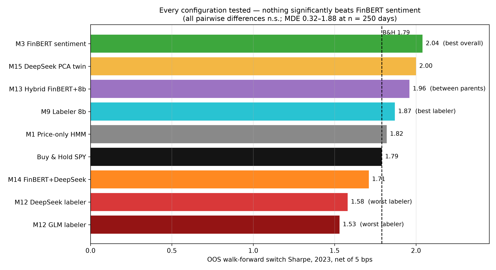
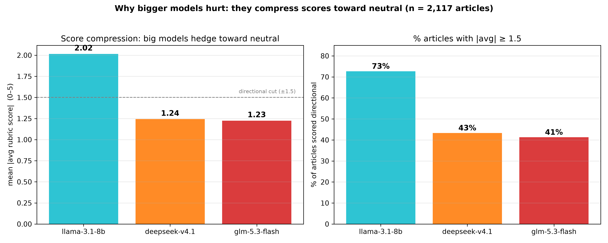
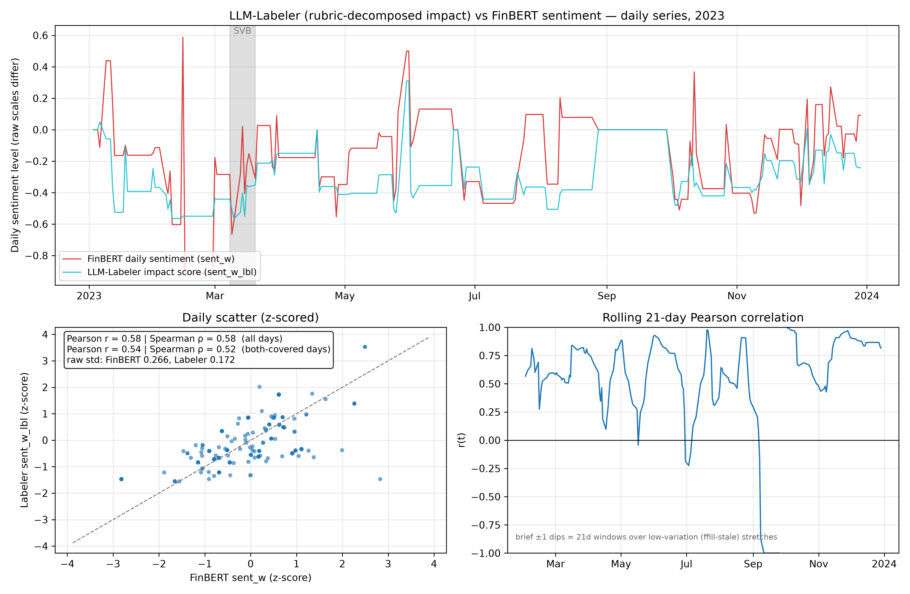
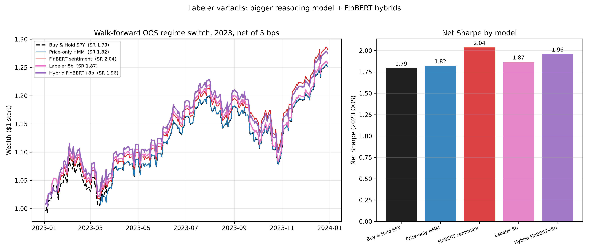
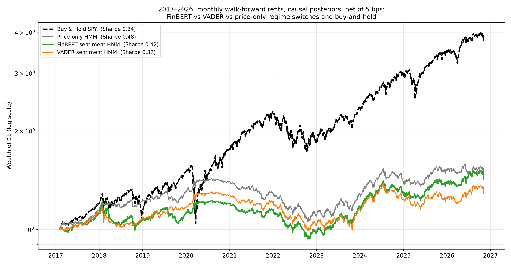
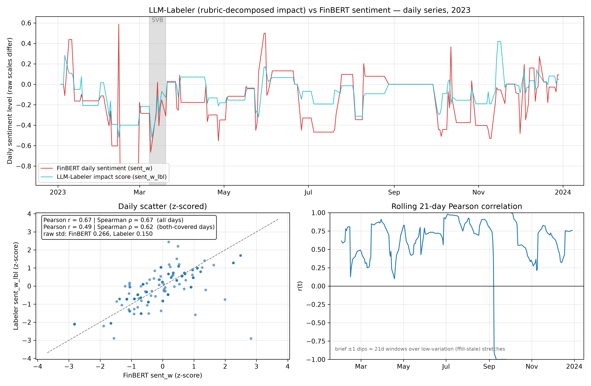
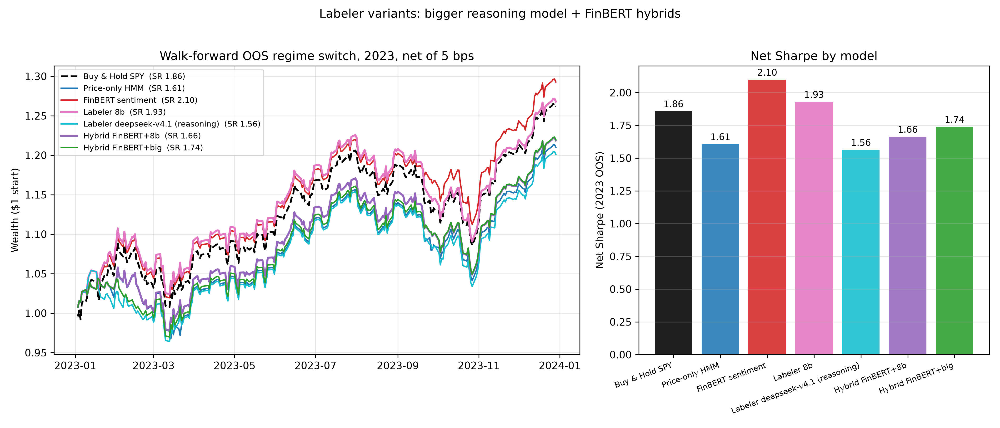
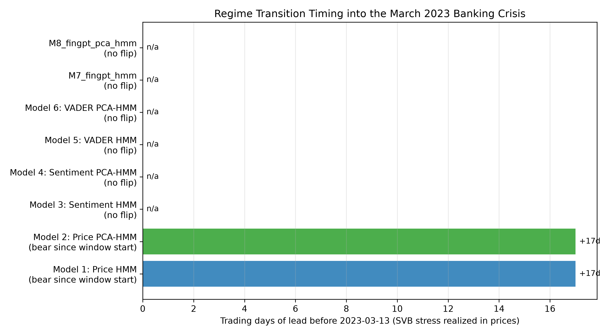
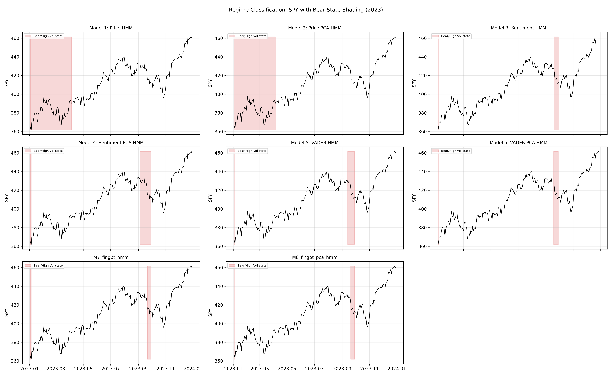

# Does LLM-Labeling Beat FinBERT for HMM Regime Detection?

**No.** We tested the [LLM-Labeler](https://github.com/zenosim/LLM-Labeler) rubric pipeline
(the LLM picks 4 impact criteria per article → scores each −5..+5 → averages → directional
call) on 2,117 real 2023 macro-news articles, fed them into HMM regime-detection models, and
traded the regimes. **FinBERT sentiment won every comparison.** Bigger LLMs made it *worse*.

> The full original benchmark (VADER/FinGPT baselines, long-window walk-forward, engineering
> findings) is archived at [`docs/BENCHMARK_ARCHIVE.md`](docs/BENCHMARK_ARCHIVE.md).

---

## The result, one chart



*OOS walk-forward regime switch, 2023, net of 5 bps. All pairwise differences statistically
indistinguishable (n = 250 days, MDE 0.32–1.85) — but the ordering is consistent in-sample
and out-of-sample, and reproduces across two independent big-model families.*

## What we tested

| # | Configuration | Scorer | HMM inputs |
|---|---|---|---|
| M3 | FinBERT sentiment (incumbent) | FinBERT | market + FinBERT tone |
| M9 | **LLM-Labeler, llama-3.1-8b** | LLM-Labeler rubric | market + labeler impact |
| M12 | **LLM-Labeler, deepseek-v4.1 (reasoning)** | LLM-Labeler rubric | market + labeler impact |
| M12′ | **LLM-Labeler, glm-5.3-flash (reasoning)** | LLM-Labeler rubric | market + labeler impact |
| M13 | **Hybrid: FinBERT + 8b labeler** | both | market + both feature sets |
| M14 | **Hybrid: FinBERT + deepseek** | both | market + both feature sets |
| M15/M16 | PCA twins of M12/M13 | — | same, PCA(0.95) |
| M1 | Price-only HMM (no news) | — | market only |
| — | Buy & Hold SPY / 60/40 | — | benchmarks |

Every model: 2-state Gaussian HMM, monthly walk-forward refits on prior data only, causal
(no-smoothing) posteriors, t−1 → t positioning, one-sided 5 bps costs, identical 2023
windows. All 2,117 articles labeled by every scorer — each label cache-stamped with
backend + model + pipeline version.

## How close did anything get?

| OOS switch Sharpe (2023, net 5 bps) | DeepSeek arm | GLM arm |
|---|---|---|
| M3 FinBERT sentiment | **2.10** | **2.10** |
| M13 Hybrid FinBERT + 8b labeler | 1.66 | 1.66 |
| M9 Labeler 8b | 1.93 | 1.93 |
| M1 price-only HMM | 1.61 | 1.61 |
| Buy & Hold SPY | 1.86 | 1.86 |
| M14 FinBERT + deepseek hybrid | 1.74 | 1.64 |
| M12 deepseek labeler | 1.45 | 1.56 |

Significance (JK-Memmel + block bootstrap, Holm across the pre-registered 5-pair
family): **nothing survives** — M9 vs M3 p = 0.14 (Holm 0.69), M9 vs M1 p = 0.62,
M9 vs B&H p = 0.75, MDE 0.32–1.85 Sharpe at 80% power.

## Why the big models lost



The reasoning models **hedge toward neutral** — "mixed signals", "already priced in"
(that phrase is literally an anchor in the scoring prompt). Mean |rubric score| drops from
**2.02** (8b) to **1.24 / 1.23** (deepseek / glm), and the share of articles scored
directional collapses from **73% → ~42%**. An HMM splits regimes on feature *variance* —
compress the feature and there is nothing left to split on. The 8B's crude, overconfident
tone readings are exactly what carries regime information; the big models reason that
conviction away.

## Same signal, extra steps



Daily labeler scores correlate with FinBERT at **r = 0.58**; the labeler's regime
posteriors at **0.86 in-sample / 0.81 OOS**. Rubric decomposition recovers the tone signal
FinBERT already provides — averaging four LLM-scored criteria doesn't add information, it
adds cost. The hybrids confirm it: combining FinBERT + labeler features lands **between**
the two parents (1.66), never ahead (M13 vs M3 p = 0.30).

---

## Charts

| Chart | What it shows |
|---|---|
|  | Every configuration, one ranking |
|  | Why big models hedge toward neutral |
|  | Big-model arms + hybrids: wealth curves & Sharpe |
|  | Daily series, scatter, rolling correlation vs FinBERT |
|  | 2017–2026 extended window: FinBERT vs VADER vs price-only vs B&H |
|  | Same, GLM arm |
|  | GLM-arm zoo (independent reproduction) |
|  | Crisis-entry timing (sentiment models missed SVB) |
|  | Regime flags on the SPY price path |

## Extended window (2017–2026): does FinBERT beat VADER with real power?


Corpus extended to **~15,000 articles across 2017-01 → 2026-11** (10 years,
2,455 trading days, 118 monthly walk-forward refits). Answer: **no.**

| OOS switch Sharpe (2017–2026, net 5 bps) | Value |
|---|---|
| M1 price-only HMM | 0.48 |
| M3 FinBERT | 0.42 |
| M5 VADER | 0.32 |
| Buy & Hold SPY | 0.84 |
| M12 deepseek labeler / M13 hybrid | 1.45 / 1.66 (2023-only, not comparable) |

- **FinBERT vs VADER: +0.10 Sharpe, JK p = 0.61, Holm 1.0** — statistically zero
  even at 2,454 days (MDE 0.52). Scorer sophistication is second-order, confirmed
  with power.
- FinBERT is slightly better where it matters (stress F1 0.46 vs 0.41 vs VADER),
  but the difference is inside noise.
- **Nothing beats buy-and-hold** over the full window: every news-switch variant
  underperforms B&H in point estimates. In this 10-year window the price-only
  HMM (0.48) also *beats* both sentiment HMMs — the 2023 in-sample ordering
  (FinBERT > price-only) does not survive out-of-sample refits.
- Disclosures: approximate (not exact) FOMC/CPI event windows; importance
  ratings skipped (unused under unweighted aggregation); 2017–2019 GDELT
  coverage is sparser than 2020+.

Tables: `extended_zoo.csv`, `extended_significance.csv`, `extended_yearly.csv`,
`extended_stress_f1.csv`, `extended_diagnostics.json`.

## Honest caveats

- n = 250 trading days → minimum detectable effect is 0.32–1.85 Sharpe. "Not significant"
  means *unproven*, not *proven equal* — but "big models worse" replicates across two
  independent model families, in-sample and OOS. Over the 2,454-day extended window the
  MDE is still 0.48–1.10.
- Annual returns are computed on a simple-return basis (corrected 2026-11-05; the
  original log-return compounding understated volatile-year returns, e.g. B&H 2020
  reported +11.7% vs true +18.3%).
- Corpus = hindsight-selected 2023 event windows + routine days (identical for every
  scorer, so the A/B is fair; absolute vs-B&H claims inherit the event-densified timing).
- All sentiment models missed the SVB crash entirely (stress F1 = 0.0 vs price-HMM 0.55).
- One article was dropped (persistent LLM parse failure); full cost/provenance trail in
  `outputs/tables/labeler_variants_diagnostics.json`.

## Reproduce

```bash
source .env                                  # OPENROUTER_API_KEY
export LLM_LABELER_BACKEND=openrouter LLM_LABELER_WORKERS=16
.venv/bin/python scripts/label_corpus.py     # label corpus (cached, resumable)
.venv/bin/python scripts/make_report_charts.py
.venv/bin/python scripts/run_labeler_zoo.py  # 8b arm zoo + significance
.venv/bin/python scripts/run_labeler_variants.py  # big-model + hybrid zoo
.venv/bin/python -m pytest tests/ -q         # 80 tests
```

Cost: ~$0.14–0.50 per full-corpus labeling pass depending on model (the deepseek arm cost
$0.50 under a hard spend cap; 8b ~$0.14).

## Artifacts

| Path | Contents |
|---|---|
| `outputs/tables/labeler_zoo_2023_oos.csv` | 8b arm: 10 models × 5 strategies, OOS |
| `outputs/tables/labeler_variants_oos.csv` | big-model arm (deepseek); `*_glm.csv` = GLM arm |
| `outputs/tables/labeler_significance.csv` | JK-Memmel + block bootstrap, Holm-corrected |
| `outputs/tables/labeler_scores_sample.csv` | 30 labeled articles with per-criterion breakdowns |
| `outputs/tables/labeler_diagnostics.json` | coverage, provenance, transitions, correlations |
| `docs/LABELER_PIPELINE.md` | methods, adaptations, bias controls |
| `docs/BENCHMARK_ARCHIVE.md` | the original full benchmark (retained) |

---
*Labels: 2,117 GDELT 2023 macro-news articles. Scorers: FinBERT, llama-3.1-8b,
deepseek-v4.1-flash, glm-5.3-flash — every label cache-stamped with backend/model/version.*
