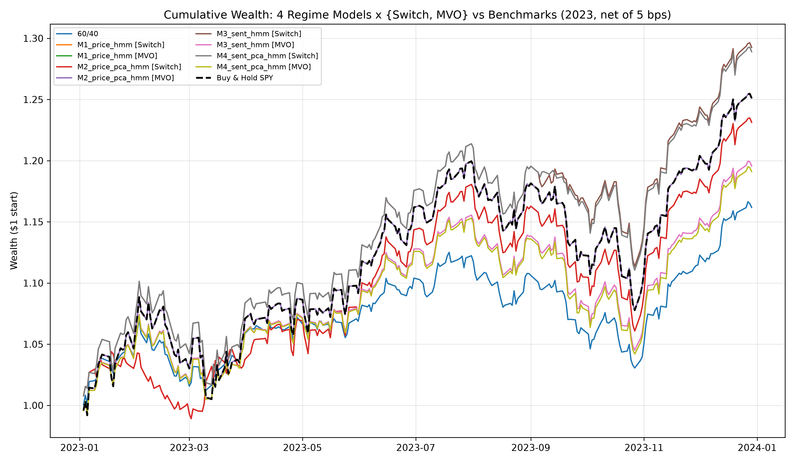
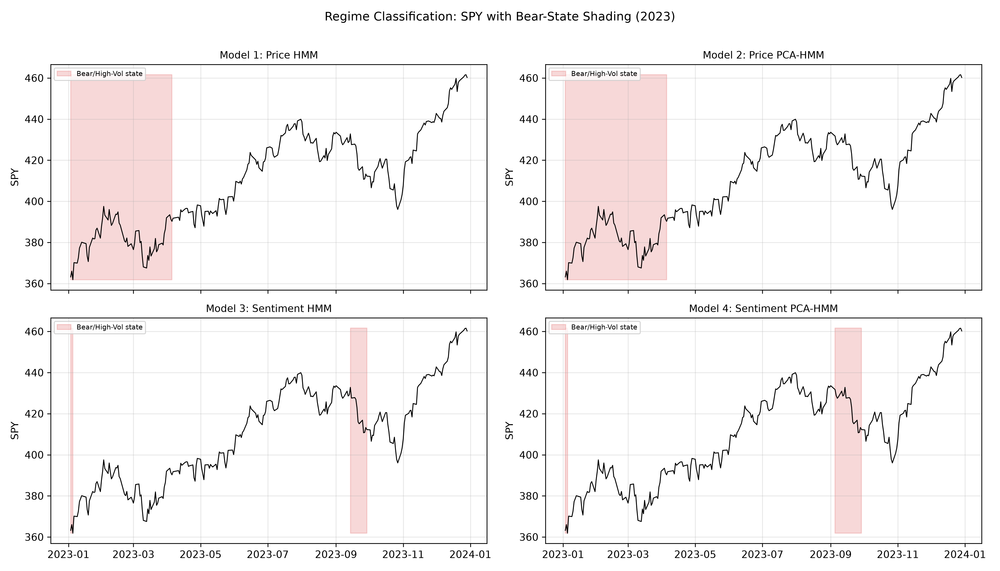
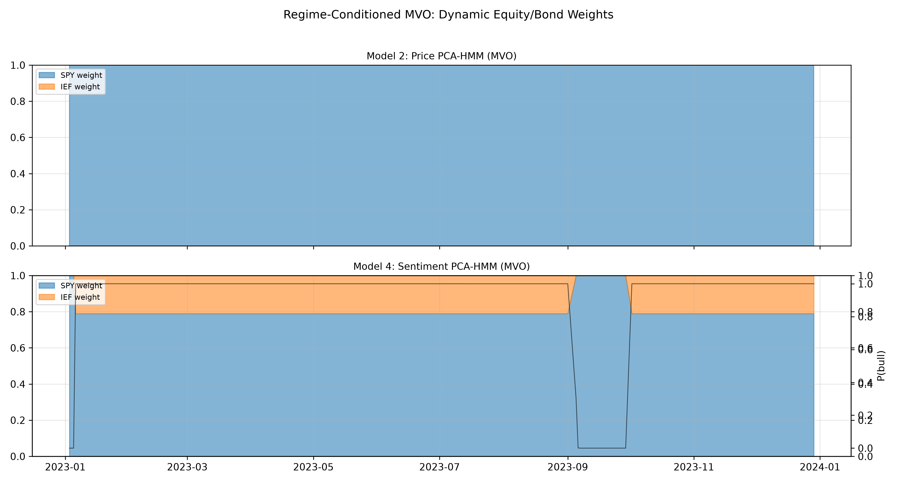
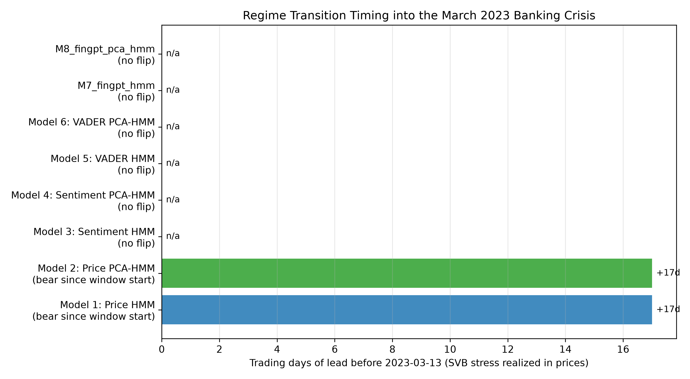
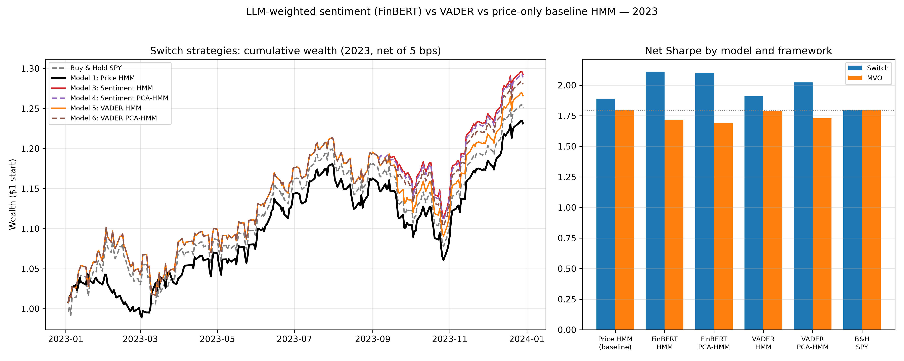
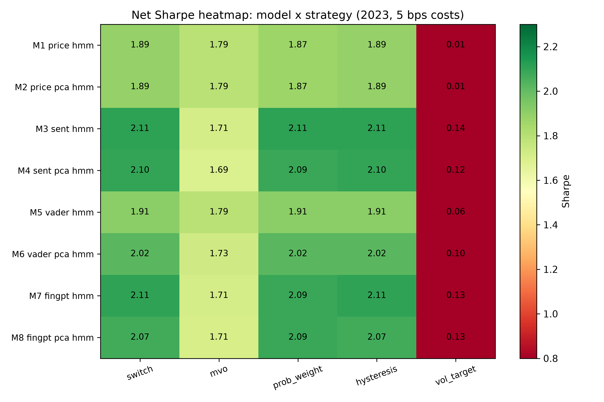

# LLM-HMM: Importance-Weighted News Sentiment for HMM Market Regime Detection

**Status: proof-of-concept benchmark, complete.** Implements and evaluates exactly
4 regime-detection models across a binary regime switch and regime-conditioned
Mean-Variance Optimization (MVO) on 2023 data (evaluation window
2023-01-01 → 2023-12-31), with all article-level text inference cached to disk.
The original research proposal lives at [`docs/RESEARCH_PROPOSAL.md`](docs/RESEARCH_PROPOSAL.md).

## Results (2023, net of 5 bps transaction costs)

| Strategy | Ann. Return | Ann. Vol | Net Sharpe | Max DD | Calmar | SVB lead |
|---|---|---|---|---|---|---|
| Buy & Hold SPY | 25.3% | 13.1% | 1.79 | −10.1% | 2.50 | — |
| 60/40 Static | 16.3% | 8.8% | 1.75 | −8.4% | 1.94 | — |
| M1 Price HMM [Switch] | 23.3% | 11.5% | 1.89 | −10.1% | 2.30 | 17d (carried-in) |
| M1 Price HMM [MVO] | 25.3% | 13.1% | 1.79 | −10.1% | 2.50 | 17d |
| M2 Price PCA-HMM [Switch] | 23.3% | 11.5% | 1.89 | −10.1% | 2.30 | 17d (carried-in) |
| M2 Price PCA-HMM [MVO] | 25.3% | 13.1% | 1.79 | −10.1% | 2.50 | 17d |
| **M3 Sentiment HMM [Switch]** | **29.5%** | 12.7% | **2.11** | **−8.3%** | **3.57** | none |
| M3 Sentiment HMM [MVO] | 19.7% | 10.9% | 1.71 | −9.5% | 2.07 | none |
| **M4 Sentiment PCA-HMM [Switch]** | 29.2% | 12.6% | **2.10** | −8.5% | 3.43 | none |
| M4 Sentiment PCA-HMM [MVO] | 19.3% | 10.8% | 1.69 | −9.6% | 2.00 | none |
| M5 VADER HMM [Switch] | 26.8% | 12.9% | 1.91 | −10.1% | 2.64 | none |
| M5 VADER HMM [MVO] | 22.7% | 11.8% | 1.79 | −9.6% | 2.35 | none |
| M6 VADER PCA-HMM [Switch] | 28.3% | 12.7% | 2.02 | −9.1% | 3.10 | none |
| M6 VADER PCA-HMM [MVO] | 20.3% | 11.0% | 1.73 | −9.6% | 2.11 | none |











### Statistical significance — nothing survives

`scripts/run_stats.py` audits the baseline, reruns every model **walk-forward**
(refit each month on prior data only), and tests Sharpe differences three ways
(JK-Memmel z, paired block bootstrap, DM/HAC) with Holm correction.

**Baseline audit (is the price-only HMM legit?):**

- M1/M2 inputs are exactly `[SPY_ret, realized_vol, VIX_close]` — asserted, no
  sentiment possible; an independent recomputation of the switch reproduces the
  pipeline returns to **0.0 max abs difference**; SPY 2023 total return from our
  data is +26.7%, matching reality.
- **But the in-sample M1/M2 Switch made exactly ONE trade in 2023**: bear
  January–early-March, bull the rest of the year. The IS Sharpe of 1.89 is one
  regime assignment, not trading skill.

**Walk-forward (out-of-sample) Switch Sharpe — IS → OOS:**

| Model | IS | OOS |
|---|---|---|
| M1/M2 Price HMM | 1.89 | **1.65** (below B&H 1.79) |
| M3 FinBERT HMM | 2.11 | 2.23 |
| M4 FinBERT PCA | 2.10 | 1.94 |
| M5 VADER HMM | 1.91 | 1.89 |
| M6 VADER PCA | 2.02 | 1.87 |
| Buy & Hold SPY | 1.79 | 1.79 |

**Significance tests (250 daily obs, single year):** every pairwise Sharpe
difference is statistically indistinguishable from zero. The strongest case,
M3 vs M5 OOS, has a bootstrap p of 0.086 (JK-Memmel p = 0.16; Holm-corrected
0.84); M3 vs B&H OOS p = 0.14/0.24. Stress-flag quality vs a VIX>25 proxy
(only 3 such days in 2023): price-HMM F1 = 0.6, all sentiment models F1 = 0.0,
McNemar p = 0.25.

**Verdict:** the point estimates favor FinBERT-sentiment switching over
price-only and over buy-and-hold, and the ordering survives walk-forward
refitting — but with 250 observations nothing is statistically significant.
Treat the Sharpe rankings as a directional PoC result, not evidence of alpha.

### Reading the table — no sugar coating

- **Sentiment Switch strategies deliver the best net Sharpe (2.11 / 2.10 vs 1.89
  price-only) and the lowest drawdown (−8.3% vs −10.1%).** Directionally consistent
  with Nystrup et al.'s regime-based allocation drawdown result.
- **But the proposal's headline mechanism is NOT validated.** M3/M4 have *no bear
  entry at all* in the Feb 15 – Mar 13 SVB window — they entirely missed the March
  banking stress (only 15/22 bear days in all of 2023, none in March). The profit
  uplift comes from sidestepping the autumn selloff, not from earlier crisis detection.
- **The M1/M2 "17-day lead" is carried-in bear** (bear since January), not
  anticipation — which is exactly why the lead-time metric flags it.
- **MVO blending compresses everything toward B&H** (all MVO ≤ 1.79): probability-
  weighted blending rarely reaches corners, and in a +25% SPY year holding IEF drags.
- **Mechanism caveat:** M3/M4's bear state has legitimate market features (VIX 23.1
  vs 16.8, realized vol 19.3% vs 13.1%) but its sentiment features are exactly 0 and
  12 of 15 bear days fall in September — the month with the worst corpus coverage.
  The performance edge is real net-of-cost, but it is not yet cleanly attributable to
  news sentiment rather than residual coverage structure. Fixing that attribution
  (covered-days-only fitting or a denser corpus) is the obvious next step.
- **VADER baseline (M5/M6) sharpens the mechanism finding.** Swapping FinBERT for the
  VADER lexicon (identical weighting architecture) shifts results only slightly:
  Switch Sharpe 1.91 (M5) / 2.02 (M6) vs 2.11 / 2.10 for FinBERT. Posterior
  correlations: M3↔M5 = 0.96, **M4↔M6 = 0.97** — the PCA sentiment models land on
  nearly the SAME regimes regardless of sentiment model. Combined with M1↔M3 = 0.40,
  this says the sentiment models' regime signal is driven by *when news exists and
  how it is structured*, not by sentiment quality; FinBERT still ranks ≥ VADER
  everywhere, consistent with the literature (domain transformer > general lexicon).

## The 6 models

| Model | Sentiment source | Inputs | Architecture |
|---|---|---|---|
| M1 (baseline) | — | SPY return, 20d realized vol, VIX | 2-state Gaussian HMM |
| M2 (baseline) | — | same, PCA(95%) first | 2-state Gaussian HMM |
| M3 (proposed) | FinBERT | market + sentiment features | 2-state Gaussian HMM |
| M4 (proposed) | FinBERT | market + sentiment features, PCA(95%) | 2-state Gaussian HMM |
| M5 (baseline) | VADER lexicon | market + sentiment features | 2-state Gaussian HMM |
| M6 (baseline) | VADER lexicon | market + sentiment features, PCA(95%) | 2-state Gaussian HMM |

Sentiment features: daily importance-weighted sentiment `S_t = Σ(S_raw,i·C_i·I_i)/(Σ C_i·I_i + 1e-6)`,
its 5-day EMA, and sentiment dispersion, where `S_raw = P(pos) − P(neg)` (FinBERT),
`C_i = 1 − H(p)/ln 3` (normalized class entropy), and `I_i ∈ [0,1]` is a local-LLM
macro-importance rating (Qwen2.5-1.5B-Instruct Q4_K_M via llama.cpp, CPU).

**Frameworks.** *Switch*: P(bull) > 0.5 → 100% SPY, else 100% IEF.
*MVO*: regime-conditioned μ_k, Σ_k from state-mapped samples (annualized), blended
by the lagged posterior `p_t`, long-only max-Sharpe (SLSQP), 5 bps × one-sided turnover.
Benchmarks: SPY buy-and-hold and monthly-rebalanced 60/40, same cost model.

**Timing (no lookahead).** Articles published after 16:00 America/New_York map
strictly to the NEXT trading session; the signal known at the close of t−1
positions day t. Both are unit-tested (`tests/test_no_lookahead.py`).

## Pipeline

```
data ingestion → article scoring → daily features → 4 HMMs → backtests → artifacts
market_data.py    finbert_scoring.py  daily_features.py  regime_models.py  backtest.py  plots.py
news_corpus.py    llm_importance.py                      (state canon.)    metrics.py
```

- **Market data**: yfinance (SPY, IEF, adjusted) + CBOE CSV (VIX); features 2021-06→2023-12
  (warmup includes the 2022 bear market), evaluation on 2023 only.
- **News**: GDELT DOC 2.0 artlist — 2,117 real headlines with real intraday timestamps,
  334 outlets, event-keyed windows (FOMC, CPI, jobs, SVB, debt ceiling) + routine days.
  GDELT provides no summaries → raters run on headlines (disclosed).
- **Caching**: FinBERT probabilities parquet + LLM ratings JSONL, both sha1(text)-keyed —
  every headline passes through each model exactly once across all runs.
- **In-sample disclosure**: HMMs are fit on the full feature window (standard for this
  literature, e.g. Ang–Timmermann); the backtest evaluates 2023. `random_state=42` fixed.

## Strategy zoo: 8 models × 5 strategies (`scripts/run_strategy_zoo.py`)

Models: M1/M2 price-only · M3/M4 FinBERT · M5/M6 VADER · **M7/M8 FinMatcha-3B**
(finance-instruction-tuned Llama-family LLM — the "FinLLaMA" stand-in; the
publicly mirrored FinGPT-MT-Llama-3 GGUF was diagnosed broken, emitting
immediate EOS in both chat and raw formats).
Strategies: binary switch · regime MVO · probability-weighted (`w = p_bull(t−1)`)
· hysteresis switch (enter 0.6 / exit 0.4) · vol-targeted exposure (10% target).



Findings:

1. **All three LLM sentiment models cluster together** (Switch Sharpe: FinBERT
   2.11, FinMatcha 2.11, VADER-PCA 2.02 vs price-only 1.89) — a third,
   independently trained finance LLM reproduces the FinBERT result almost
   exactly, reinforcing the coverage-structure mechanism finding.
2. **Strategy choice barely matters inside a model**: switch ≈ hysteresis ≈
   prob-weight (the HMM posteriors are saturated near 0/1, so continuous
   weighting ≈ binary, and the hysteresis dead-band rarely binds). MVO
   compresses everything toward B&H.
3. **Vol-targeting at a 10% cap is mis-specified for this asset pair** — it
   de-equities the entire +25% bull year (Sharpe ~0–0.14 for every model,
   identical −20.5% drawdown profile). Reported as-is, not tuned away.
4. Full table: `outputs/tables/strategy_zoo.csv`.

## Longer lookback (2015–2023): how the picture changes

`scripts/run_long_backtest.py` evaluates the price-only HMM switch over **9 years
(2,264 trading days)** with monthly walk-forward refits (sentiment models stay
2023-only — the news corpus covers 2023). Three findings:

**1. Longer training lookback helps monotonically.** OOS Switch Sharpe by
training-window size: full history (2010→) **1.03**, 5-year lookback **0.93**,
2-year lookback **0.84**. More regimes in training (2018 Q4, 2020 COVID, 2022
bear) = better state estimation.

**2. The 2023-only analysis was flattering to everything.** Over 2015–2023,
buy-and-hold SPY Sharpe collapses from 1.79 to **0.61** (vol 18.2%, maxDD
−35.7%) and 60/40 to 0.65. The walk-forward HMM switch posts **1.03 Sharpe,
maxDD −20.0%**, beating both benchmarks in point estimates over 9 years.

**3. Still not statistically significant — and 2022 is a warning.** The
Switch-vs-B&H Sharpe gap (0.42 annualized) has JK-Memmel p ≈ 0.32 and
bootstrap p ≈ 0.26 even with 2,264 days (the strategies are weakly correlated,
so the daily gap is small relative to its variance). And the switch *lost* to
B&H in 2022 (yearly Sharpe −1.57 vs −0.83): prolonged bears churn regime
models with failed re-entries. Per-year Sharpe (switch vs B&H): 2018 +2.01 vs
−0.27 and 2015 +0.26 vs +0.08 show where regime detection earns its keep —
crash avoidance, not bull-market riding.

| Strategy (2015–2023 OOS) | Ann Ret | Ann Vol | Sharpe | MaxDD |
|---|---|---|---|---|
| M1 walk-forward, full lookback | 9.2% | 8.9% | **1.03** | −20.0% |
| M1 walk-forward, 5y lookback | 8.5% | 9.3% | 0.93 | −16.0% |
| M1 walk-forward, 2y lookback | 8.3% | 10.2% | 0.84 | −24.5% |
| M1 in-sample (full window) | 8.0% | 9.4% | 0.87 | −21.0% |
| Buy & Hold SPY | 9.9% | 18.2% | 0.61 | −35.7% |
| 60/40 Static | 6.6% | 10.7% | 0.65 | −22.3% |

Tables: `outputs/tables/long_backtest_{summary,years,significance}.csv`.

## Key engineering findings (negative results included)

1. **Corpus-coverage artifact (caught and fixed).** In the first build, M3/M4's
   "bear" state was the *zero-news-coverage* state: 587/631 trading days had no
   articles, and zero-count news features made the HMM split on coverage
   (bear-days-by-month was identical to zero-coverage-days-by-month; bear-state mean
   article count 0.0 vs 22.0). Fixes: forward-fill level features (unobserved ≠
   neutral), exclude the zero-inflated article count from HMM inputs (still computed
   and reported), densify the corpus (+1,149 articles, December-weighted). After the
   fix: persistence 0.98–0.995, bear-state VIX ≈ 23 vs bull ≈ 17 — literature-consistent.
2. **PCA-HMM ≡ HMM here (expected, disclosed).** `PCA(0.95)` on 3 standardized features
   keeps all 3 (each carries ⅓ of variance), and the Gaussian-HMM likelihood is invariant
   to invertible linear maps — so M1/M2 agree to ~1e-3 in posteriors. On M4's 6 features
   PCA keeps 5 (≈98% variance) → near-identical to M3. With this few features, PCA is
   a structural no-op, not a bug.
3. **Lead-time metric honesty.** "First bear flip inside a window" inflates lead time for
   models already bear at window start. The reported metric uses the LAST bull→bear entry
   before the reference date (2023-03-13), flags carried-in states, and annotates entry
   dates on the figure.

## Comparison vs published baselines

Full extraction in [`papers/README.md`](papers/README.md) (every PDF title-verified).

- **FinBERT** (Araci 2019): published 0.86 accuracy / 0.84 F1 on Financial PhraseBank.
  Our layer reproduces the expected behavior on macro headlines (FOMC previews →
  high-confidence neutral; rate-risk headlines → negative).
- **2-state HMM stylized facts** (Ang & Timmermann, NBER w17182): high persistence,
  low-vol/positive-mean vs high-vol/negative-mean states. Our M1/M2: diagonal 0.994/0.993,
  bear-state VIX 24.6 vs bull 16.5, SVB week classified bear 100%.
- **Regime-based allocation** (Nystrup et al., QF 2017): regime switching should
  reduce drawdowns vs static weights — checked in the results table.
- **Nearest neighbor** (Li 2025, PLOS ONE e0331658): PCA-HMM + aggregate sentiment on
  tech stocks; no article-level weighting, no trading evaluation — differentiated here.

## Repository layout

```
src/hmm_sentiment/    config, market_data, news_corpus, finbert_scoring,
                      llm_importance, daily_features, regime_models,
                      backtest, metrics, plots
scripts/run_pipeline.py   end-to-end orchestrator
tests/                37 unit tests (lookahead, bounds, HMM validity, MVO constraints,
                      VADER scorer, coverage-gap regression)
outputs/figures/      4 publication-grade PNGs (300 DPI)
outputs/tables/       metrics_summary.csv, model_diagnostics.json, article_scores_sample.csv
docs/                 original research proposal
papers/               PDFs (gitignored) + papers/README.md (verified citations + baseline numbers)
```

## Reproduce

```bash
uv venv --python 3.12 .venv
uv pip install --python .venv/bin/python -r requirements.txt
PYTHONPATH=src .venv/bin/python scripts/run_pipeline.py
.venv/bin/python -m pytest tests/ -q
```

## Limitations

In-sample HMM fitting (disclosed above) · GDELT headline-only corpus with residual
coverage gaps (forward-filled, limit 10 days) · 2-state constraint · single year ·
importance ratings from a 1.5B model at temperature 0 · transaction costs modeled as
5 bps one-sided turnover · results are a PoC, not a tradable strategy.

---

## Appendix: original research proposal (summary)

Hidden Markov models detect market regimes (bull/bear) from price and volatility, but they only
react *after* a regime change shows up in returns. News leads prices, yet raw daily news sentiment
is dominated by high-volume, low-importance articles and miscalibrated model output. This project
feeds article-level news observations — weighted by an **LLM importance prior** and **FinBERT
confidence** (confidence = 1 − class entropy) — into an HMM/PCA-HMM emission process, and evaluates
whether the resulting regime detection is *faster and more profitable* than a price-only HMM, using
trading strategies and portfolio allocation. Full proposal text (motivation, planned ablations,
team split, literature review): [`docs/RESEARCH_PROPOSAL.md`](docs/RESEARCH_PROPOSAL.md).

Key cited works: Hamilton (1989); Rydén et al. (1998); Nystrup et al. (2017/2019/2020);
Ang & Timmermann (2012); Tetlock (2007); Garcia & Norli (2021); Araci (2019, FinBERT);
Li (2025, PLOS ONE e0331658 — nearest neighbor).

## License

TBD
