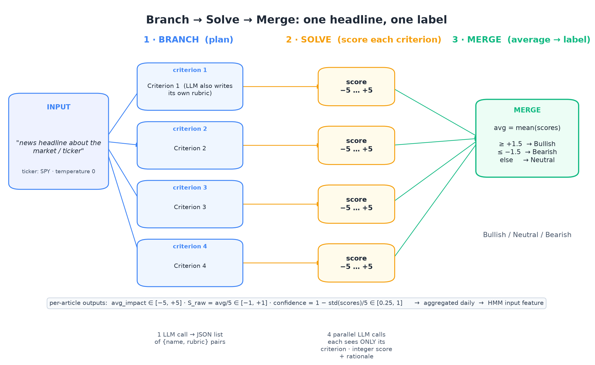
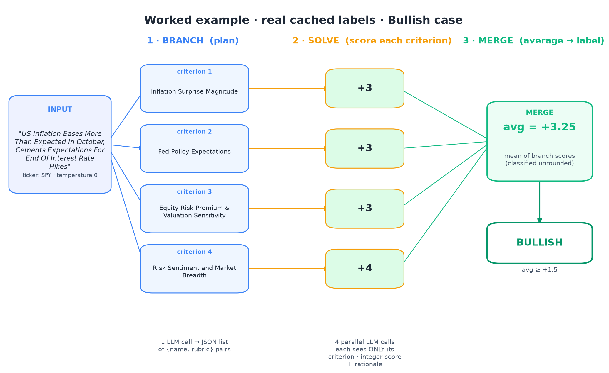
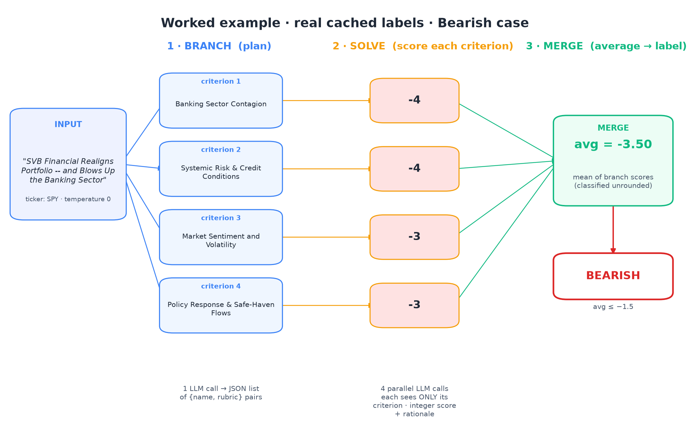
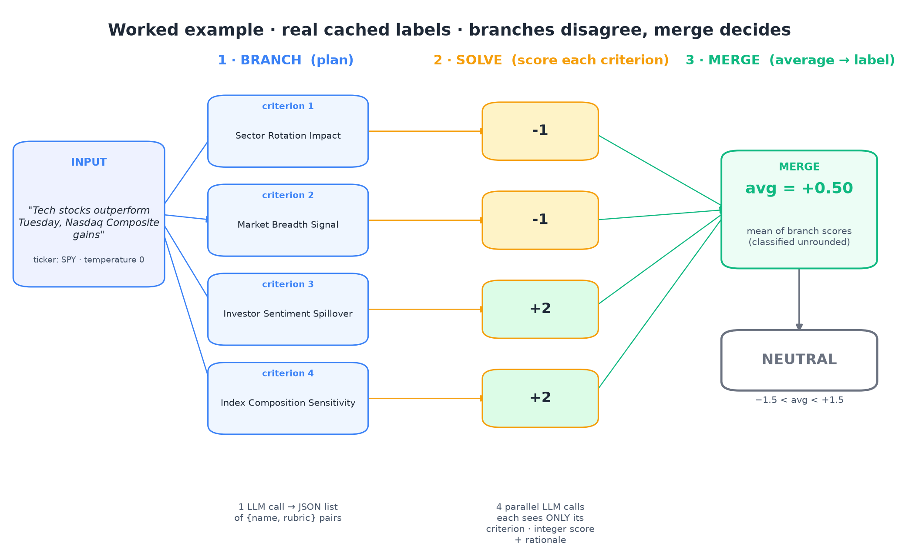
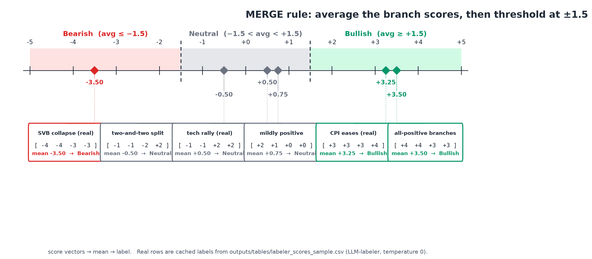
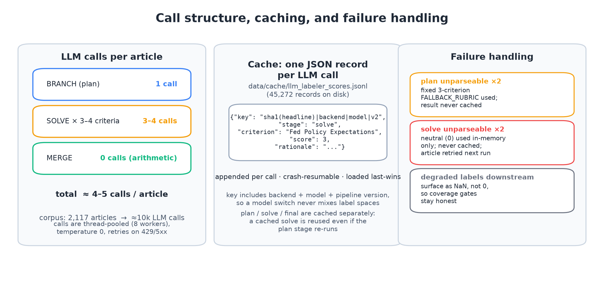
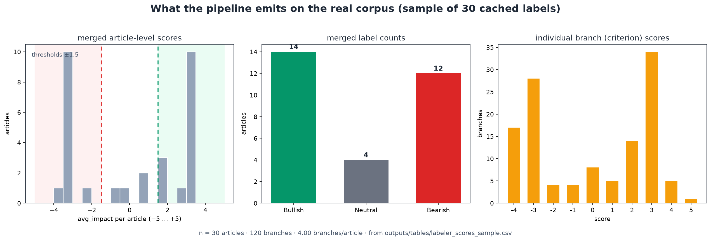

# Branch → Solve → Merge (rubric-decomposition labeling) — visual explainer

Mechanics of the pipeline only. Generated by `make_bsm_figures.py` (paths are
script-relative; run with the repo venv from the repo root:
`.venv/bin/python docs/bsm_explainer/make_bsm_figures.py`).

**One-line idea:** instead of asking the LLM for a single sentiment score per
article, the pipeline makes three smaller calls — one to *branch* the problem
into up to 4 self-authored criteria, one per criterion to *solve* a −5…+5
impact score, and a deterministic arithmetic *merge* (mean, then ±1.5
thresholds) that produces the final label.

## The figures

| Figure | What it shows |
|---|---|
|  | Full pipeline: 1 headline → 1 plan call → N solve calls → mean → label. Per-article outputs (`avg_impact`, `S_raw`, `confidence`) feed the daily aggregation that becomes the HMM input feature. |
|  | Real cached bullish example: Oct-2023 CPI headline, 4 branch scores (3, 3, 3, 4) → mean +3.25 → Bullish. |
|  | Real cached bearish example: SVB headline, scores (−4, −4, −3, −3) → −3.50 → Bearish. |
|  | Real cached disagreement example: tech-rally headline, branches split (−1, −1, +2, +2) → +0.50 → Neutral. |
|  | The merge rule on the −5…+5 scale: mean ≥ +1.5 → Bullish, ≤ −1.5 → Bearish, else Neutral. Six score-vector examples, three of them real cached rows. |
|  | Call structure (≈4–5 LLM calls per article; ≈10k calls for the 2,117-article corpus), the append-per-call JSONL cache keyed by `sha1(headline)|backend|model|v2`, and failure handling (fallback rubric / neutral fallbacks are never cached). |
|  | What the pipeline emits on the real 30-article sample: merged-score distribution, label counts (14 Bullish / 4 Neutral / 12 Bearish), and the 120 individual branch scores. |

## Stage mechanics

1. **BRANCH (plan)** — one LLM call, temperature 0. Prompt asks for "an
   evaluation plan of up to 4 distinct criteria/dimensions", each with a
   `name` and a self-authored `rubric`. Response must parse as a JSON list
   (balanced-bracket extraction); capped at 4 criteria.
2. **SOLVE** — one LLM call per criterion, runnable in parallel. Each call sees
   the headline, the ticker, and exactly one criterion + rubric, and must
   return `{"score": int ∈ [−5, +5], "rationale": str}`. Scores are clamped to
   [−5, +5].
3. **MERGE** — no LLM. Mean of the branch scores (classification uses the
   unrounded mean): ≥ +1.5 → Bullish, ≤ −1.5 → Bearish, otherwise Neutral.
   Reported outputs per article: `avg_impact`, `S_raw = avg_impact/5 ∈ [−1, 1]`,
   `confidence = 1 − std(scores)/5` (clipped to [0.25, 1]), `n_criteria`.

## Operational facts

- Corpus: 2,117 macro/index headlines, ticker fixed to **SPY** (disclosed
  substitution; the traded assets in the HMM zoo are SPY/IEF).
- ≈4–5 LLM calls per article → ≈10k calls total; thread-pooled (8 workers),
  retries with backoff on 429/5xx.
- Cache: `data/cache/llm_labeler_scores.jsonl`, one JSON record appended per
  LLM call (crash-resumable, loaded last-wins; 45,272 records on disk). Key =
  content hash + backend + model + pipeline version, so different models never
  share a label space.
- Failure handling: an unparseable plan twice → fixed 3-criterion
  `FALLBACK_RUBRIC` (in-memory only, never cached); an unparseable solve twice
  → neutral (0) in-memory only, never cached. Degraded articles surface as
  NaN downstream, not as 0-scores.
- Reference implementations: `zenosim/LLM-Labeler/simple_bsm.py` (original) and
  `src/hmm_sentiment/labeler_scoring.py` (production, backend-selectable).
- Example rows in the figures are verbatim from
  `outputs/tables/labeler_scores_sample.csv`.
